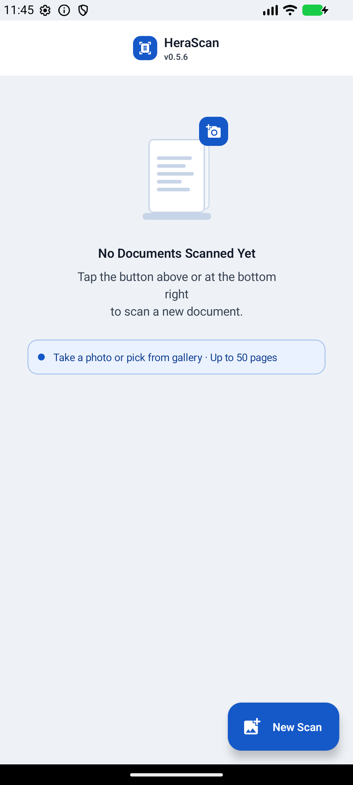
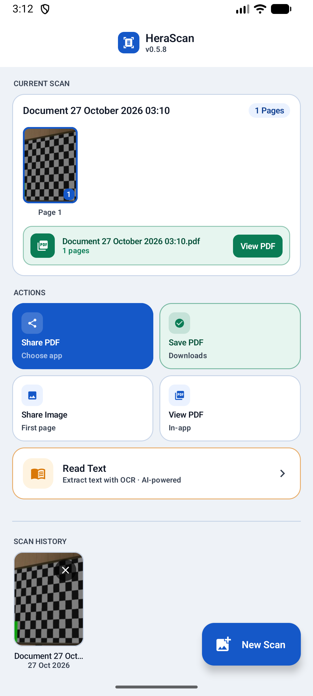
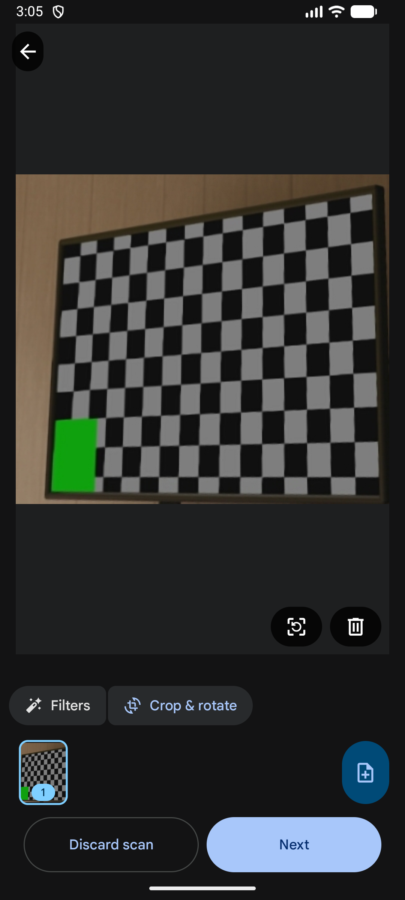
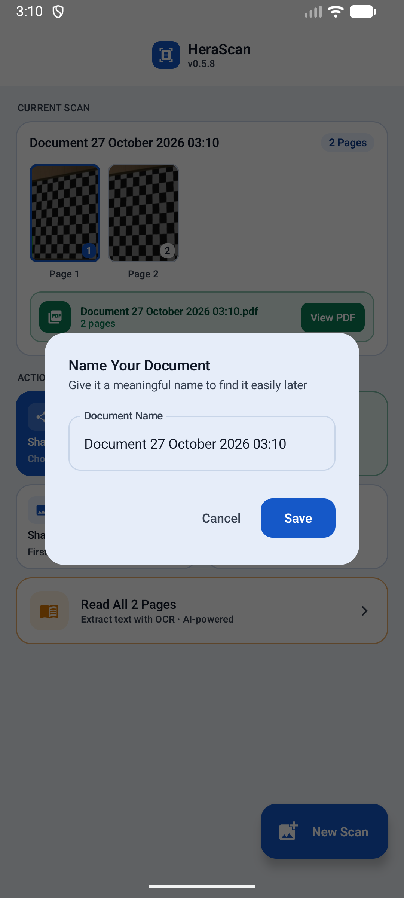
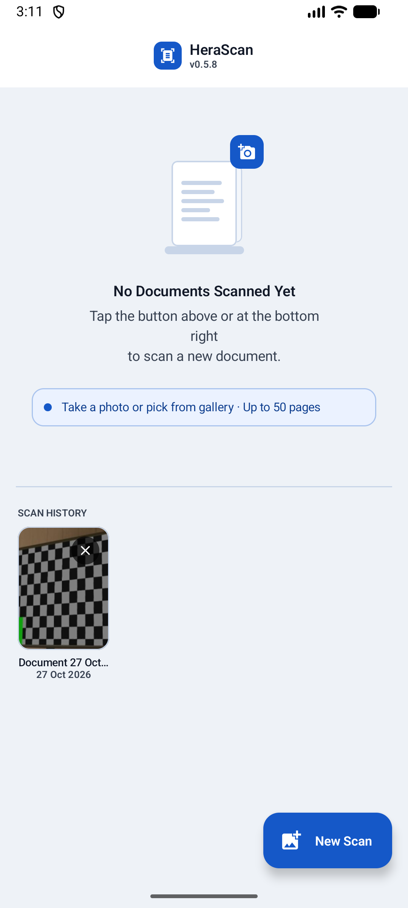
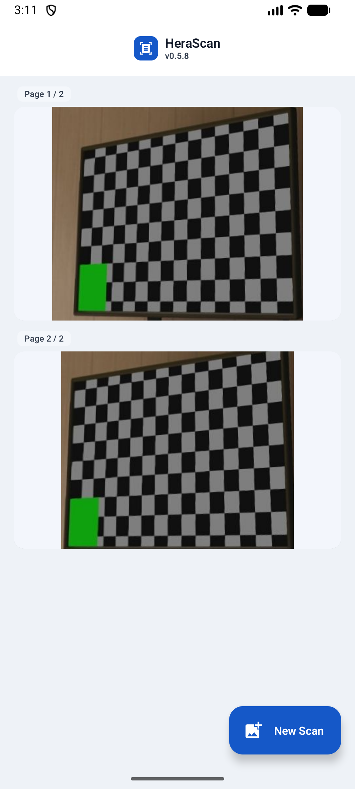

# HeraScan — on-device document scanner for Android

> Türkçe: [README.tr.md](./README.tr.md)

**Scan paper, get a PDF, read it back. Nothing leaves the phone.**

HeraScan is a single-activity Jetpack Compose app that turns a camera pass or a gallery image into a multi-page PDF, reads text out of it offline with ML Kit, and keeps the result in a local history you can reopen, rename or delete.

Every step — scanning, OCR, history — runs on the device. There is no account, no upload, no server.



---

## Contents

- [What it does](#what-it-does)
- [Screens, one by one](#screens-one-by-one)
  - [1. Home](#1-home)
  - [2. Scan result](#2-scan-result)
  - [3. Crop and rotate](#3-crop-and-rotate)
  - [4. Name the document](#4-name-the-document)
  - [5. History](#5-history)
  - [6. PDF viewer](#6-pdf-viewer)
- [Install](#install)
- [Permissions](#permissions)
- [Where files go](#where-files-go)
- [Build from source](#build-from-source)
- [Known limits](#known-limits)
- [License](#license)

---

## What it does

| Capability | Detail |
|---|---|
| **Document scanner** | ML Kit Document Scanner, FULL mode, gallery import, 50-page limit per scan |
| **Outputs** | JPEG per page and a combined PDF |
| **Offline OCR** | on-device ML Kit Text Recognition (Latin), result in a bottom sheet |
| **PDF viewer** | in-app paging through the scanned PDF |
| **Save and share** | PDF to Downloads, OCR text to `Documents/HeraScan`, share via FileProvider |
| **History** | Room database with Paging 3, page size 20; reopen, rename, delete |
| **Smart naming** | rename dialog with a date-prefixed default name in Turkish format |
| **Cache hygiene** | scan cache older than 24 hours is cleaned automatically |
| **Turkish UI** | `tr-TR` strings and date formatting |
| **Material 3** | Compose, Coil for thumbnails, dynamic colour off for a stable look |

---

## Screens, one by one

### 1. Home


The empty state, and the app's only screen with no document loaded.

- **Header** — logo, `HeraScan`, and the running version (`v0.5.8`).
- **Empty illustration** — *"No Documents Scanned Yet"*, then the hint *"Take a photo or pick from gallery · Up to 50 pages"*.
- **New Scan** — the blue action button, bottom right.

Tapping either the illustration or **New Scan** hands off to ML Kit's scanner. There is no in-app camera preview to learn: the system UI does the capture, cropping and filtering.

### 2. Scan result



Once a scan is saved, the result card becomes the top of the screen.

- **CURRENT SCAN** — the document name, page count and page thumbnails.
- **PDF block** — the generated file (`Document 27 October 2026 03:10.pdf`), its page count and **View PDF**.
- **ACTIONS** — four paths, each with the destination under it:
  - **Share PDF** → *Choose app*
  - **Save PDF** → *Downloads*
  - **Share Image** → *First page*
  - **View PDF** → *In-app*
- **Read All Pages** — *Extract text with OCR · AI-powered*, the offline OCR pass over every page.

Each action names where it lands, so nothing has to be guessed before tapping.

### 3. Crop and rotate



ML Kit's review step, before the pages are committed.

- **Filters** — the colour and contrast presets applied to the page.
- **Crop & rotate** — per-page corner adjustment and rotation.
- **Page strip** — `Page 1 of N`, add another page, or delete one.
- **Discard scans** — throws the whole batch away.
- **Next** — accepts the batch and moves to naming.

The capture is deliberately left to ML Kit: edge detection and perspective correction are its job, and the app does not re-implement them.

### 4. Name the document



The naming dialog that closes a scan.

- **Title** — *Name Your Document*.
- **Hint** — *"Give it a meaningful name to find it easily later"*.
- **Default** — a date-prefixed name in Turkish format (`Document 27 October 2026 03:06`), already selected so typing replaces it.
- **Cancel** / **Save**.

The name becomes the PDF filename and the history entry, so the default is readable rather than a random identifier.

### 5. History



The home screen once documents exist.

- **SCAN HISTORY** — a paged grid of scans, newest first, page size 20.
- Each tile shows the first-page thumbnail, the document name and the date (`27 Oct 2026`).
- **Long-press or the delete affordance** removes an entry after confirmation.

History is a Room table plus Paging 3, so a long archive stays cheap to scroll: it does not load every row to render the first screen.

### 6. PDF viewer



The in-app reader, reached from **View PDF** on the result card or from a history entry.

- **Page indicator** — `Page 1 / 2`.
- **Vertical paging** — one page per screen, swipe between them.
- **No editing** — the viewer reads; to change a document you rescan it or delete it.

Opening a scan here is the fastest check that the PDF is readable before sharing it.

---

## Install

HeraScan ships as an APK:

1. Copy `HeraScan-0.5.8.apk` to the device.
2. Allow installation from that source when prompted.
3. Open the app and grant camera access on the first scan.

Android 8.0 (API 26) or newer; built and tested against Android SDK 34 on Android 15.

## Permissions

| Permission | Why |
|---|---|
| **Camera** | capturing pages, through ML Kit's scanner UI |
| **Storage / MediaStore** | writing the PDF to Downloads and OCR text to `Documents/HeraScan` |
| **Internet** | only for the one-time ML Kit model download; scanning and OCR then run offline |

No account, no analytics, no crash reporting.

## Where files go

| Artifact | Location |
|---|---|
| PDF | Downloads (via MediaStore) |
| OCR text | `Documents/HeraScan` |
| History and thumbnails | app-internal Room database |
| Scan cache | app cache, cleaned after 24 hours |

Deleting a history entry removes the app's record; files already saved to Downloads or Documents stay where they are.

## Build from source

Requirements: JDK 17, Android SDK 34, Gradle wrapper in the repo.

```powershell
./gradlew test lint assembleDebug
```

Release APK:

```powershell
./gradlew assembleRelease
```

The signing config is read from `keystore.properties`, which is git-ignored and never committed. Without it a release build produces an unsigned APK.

## Known limits

- **The package id is `com.seninadin.herascan`.** It is the app's identity on the device: changing it would make every existing install a separate app and break updates. It is unrelated to the source repository name.
- **OCR is Latin only.** Other scripts need a different ML Kit recogniser.
- **No in-app camera.** Scanning goes through Google's ML Kit scanner UI; a device without Google Play services cannot scan.
- **No cloud backup.** History lives in app storage; uninstalling removes it.
- **No batch export.** Documents are shared one at a time.

## License

MIT — see [LICENSE](./LICENSE).
